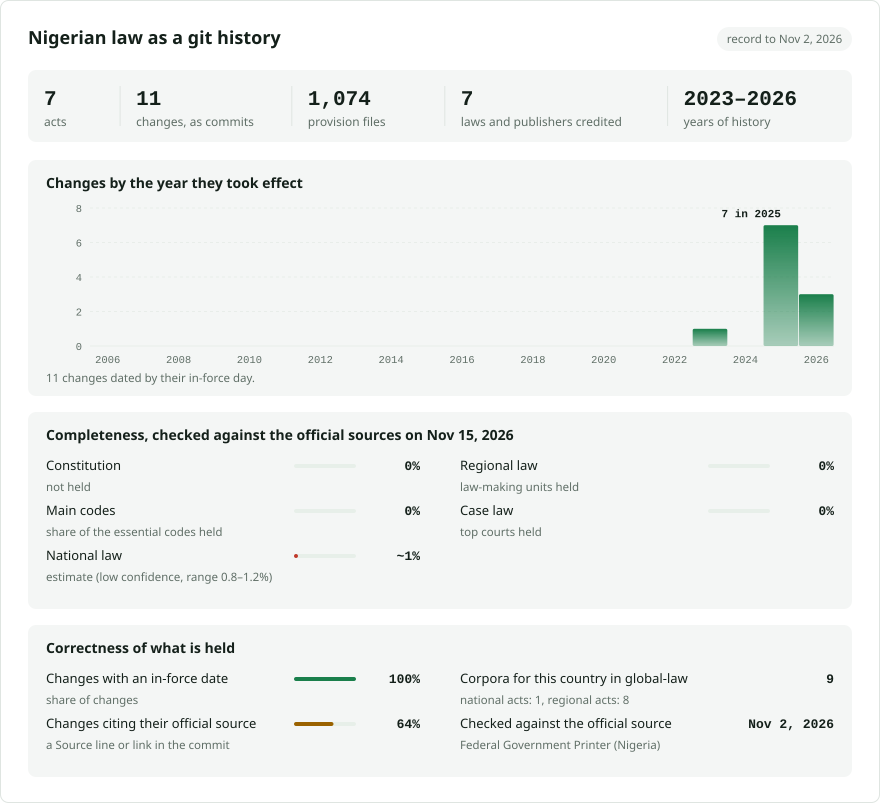

# Nigeria: law history in git

<picture>
<source media="(prefers-color-scheme: dark)" srcset="data/effort-dark.svg">

</picture>

The federal law of Nigeria as a git history: one file per section, one commit per version on the day it took effect, and the law that made each change as the commit's author. `git blame` names the law behind every paragraph; `git log` lists every change to a section; picking a date gives the text in force that day.

Part of [lexifina/global-law](https://github.com/lexifina/global-law), one git history for every country's law: this is Nigeria's federal law, which global-law reads at `nigeria/national/acts/`.

**What is in it now:** the Constitution of 1999 as promulgated, with the sixteen Fifth Alteration Acts of 2023 recorded beside it; 558 federal Acts in `acts/`: the Laws of the Federation of Nigeria 2004 (544 Acts, among them the Criminal Code, the Penal Code (Northern States) Federal Provisions Act, the Evidence Act, the Labour Act and the Interpretation Act), the Companies and Allied Matters Act, 2020, and about 25 later Acts (among them the Evidence Act, 2011, the Electoral Act, 2022, the Copyright Act, 2022 and the Terrorism, Money Laundering and Proceeds of Crime Acts, 2022); subsidiary legislation printed under 87 of them, in `subsidiary/`; the 7 recent Acts listed below; and, from FAOLEX and WIPO Lex copies (secondary sources, each commit says so), about 60 more Acts since 2003 (among them the Petroleum Industry Act, 2021, the Electricity Act, 2023, the Freedom of Information Act, 2011, the Nigerian Minerals and Mining Act, 2007 and the Nigeria Customs Service Act, 2023) and 133 federal regulations and rules of court in `subsidiary/`. [`REPRODUCE.md`](REPRODUCE.md) lists sources.

`acts/<short-title>/` holds one file per section or Schedule (`acts/criminal-code-act/section-001.md`); `constitution/` likewise, with the Alteration Acts in `constitution/alterations/`, not yet applied to the sections. An Act re-enacted under the same short title replaces the earlier text in the same folder (the Evidence Act, 2011 replaces the LFN Evidence Act on its day). The 7 recent Acts taken from gazettes before this layout stay in their own folders (`data-protection/sec-037.md` is section 37 of the Nigeria Data Protection Act, 2023).

The text is in English, as the Federal Government Printer prints it.

## Questions as git commands

| Question | Command |
| --- | --- |
| Every change to section 37 of the Nigeria Data Protection Act | `git log -p --word-diff -- data-protection/sec-037.md` |
| Which law wrote each line of section 37? | `git blame data-protection/sec-037.md` |
| Every version of the Act, with the day each took effect | `git log --format="%h %(trailers:key=In-force,valueonly,separator=) %an" -- data-protection ':!*/README.md'` |
| Section 37 as in force on 1 January 2024 | `python tools/on.py 2024-01-01 data-protection sec-037` |

**Outside git**, we also host this record publicly, for free:

- **[Ask Claude about Nigerian law](https://global-law.lexifina.com/v1/try_claude?country=nigeria)**: opens Claude with a first question ready.
- **[Ask ChatGPT](https://global-law.lexifina.com/v1/try_chatgpt?country=nigeria)**: the same question in ChatGPT.
- **[Search Nigerian law on our site](https://lexifina.com/law?country=nigeria&q=personal+data)**: a search for "personal data", with each provision's text and its versions, no account needed.
- **[Developer REST API](https://global-law.lexifina.com/v1/search_law?query=personal+data&jurisdiction=nigeria)**: the same search as JSON, with no key. See the [documentation here](https://lexifina.com/api/global-law).

Both assistants read the record through the free Global law connector (MCP, `https://global-law.lexifina.com/mcp`); the first time, the chat gives you the link that adds it. Ask in English.

**Host it yourself easily.** All it takes is git and Python, and the tools run on your machine:

```sh
git clone --depth 1 https://github.com/lexifina/global-law && cd global-law
python3 tools/countries.py add nigeria/national/acts
python3 tools/law.py show 2026-01-01 nigeria/national/acts/data-protection/sec-037.md
```

Opened in Claude Code, Cursor, VS Code or Codex, the clone also starts a local MCP server with the same tools ([MCP.md](https://github.com/lexifina/global-law/blob/main/MCP.md)).

## Dates

Each commit is dated at noon, Africa/Lagos, on the day the version took effect, and carries it in its `In-force:` trailer:

- for an Act, the commencement date printed under its long title in the gazette ("[12th Day of June, 2023]"); the day of assent and the gazette's date are the `Enacted:` and `Published:` trailers; where no day can be read, 31 December of the Act's year, marked as a placeholder in `In-force-basis:`;
- for the Laws of the Federation of Nigeria 2004, 31 December 2002, the day to which that revision states the law; each Act's own commencement is the `Commenced:` trailer;
- for the Constitution, 29 May 1999;
- no day is computed from a default rule: the Nigeria Tax Act, 2025, gazetted on 26 June 2025, is dated 1 January 2026, the commencement date it prints.

Each Act is credited to itself, as the gazette numbers it (`Act No. 37 of 2023 <act-2023-37@federal-government-printer.invalid>`). So are the four later commits that correct 11 section headings in four Acts (a printer's cross-reference note had been read into the heading); they change no words of the law. The committer is Lexifina.

## How it is checked

- `tools/check_repo.py` reads every version back from git on the day it took effect and on the day before, and compares it with the corpus: 7 versions of 7 acts, 0 mismatches (see [`REPRODUCE.md`](REPRODUCE.md)). The Constitution, LFN and PLAC commits are not yet in that check.
- Word for word against the print: every word of each Act's enacted text as printed is in a provision file or in a Part or Chapter heading, and no word is added.
- Against today's law: no amending Act was found for any of the seven in the National Assembly's list of Acts or the National Library of Nigeria's repository (checked 2026-11-02); acts not checked to be today's text stay off `main`.
- History is append-only: no merge commits, no commit dates that go backwards, none dated after the build, and every commit's trailers parse; a text found wrong later is corrected in a new commit, not rewritten.
- [vulnerabilities/](vulnerabilities/): possible drafting mistakes in this law, found by global-law's detectors and checked by hand. Not run yet.

## What it does not show

- **Amendments since 2002, mostly.** The LFN 2004 texts are the 2002 revision; amending Acts after it are applied only where a whole new Act was taken. About 30 later Acts (among them the Administration of Criminal Justice Act, 2015, the Police Act, 2020, the Nigerian Correctional Service Act, 2019 and the Immigration Act, 2015) are found only as page scans with no text layer and are not here; neither are two LFN Acts in the same state. Lexifina runs no OCR.
- **The Constitution as in force.** The sections are the 1999 text as promulgated; the First to Fourth Alterations (2010 to 2018) are not here, and the Fifth Alteration Acts (2023) are recorded beside it, not applied. The Companies and Allied Matters Act, 2020 is without the Business Facilitation (Miscellaneous Provisions) Act, 2022.
- **Text quality.** Some PLAC PDFs are page scans with the publisher's own OCR text layer (the Labour Act, the Evidence Act, 2011), as are many FAOLEX copies (the Petroleum Industry Act, the Electricity Act); those commits say `Text-source: publisher OCR`, and their text has the OCR's errors. Section splitting is automatic; an Act whose numbering could not be read is one `text.md`.
- **Case law.** Supreme Court judgments with a text layer are kept in a separate private repository.
- **Part and Chapter headings and the printer's cross-reference side notes** are left out; each file starts with its section number and heading. Misprints and spelling errors are kept as printed.
- **Table layout.** Tables in Schedules are read line by line as printed, so a cell that runs over several printed lines is split across lines (the Nigeria Tax Act's Ninth and Tenth Schedules).

## Sources

| Source | Kind | Past versions | Notes |
| --- | --- | --- | --- |
| Federal Government Printer, Official Gazette of the Federal Republic of Nigeria | Official gazette: each Act as enacted | no, the text as enacted | Read from copies with a text layer (no OCR); each copy's address is in `REPRODUCE.md` and its sha256 in `data/versions.json` |
| [Policy and Legal Advocacy Centre](https://placng.org/lawsofnigeria/), The Complete 2004 Laws of Nigeria | The Laws of the Federation of Nigeria 2004, as HTML pages and PDFs | no, the 2004 revision | 544 Acts and the subsidiary legislation printed under them; HTML or the PDF's text layer, no OCR by Lexifina |
| [Policy and Legal Advocacy Centre](https://placng.org/i/acts/), Acts | PDFs of Acts since 2003 and the Fifth Alteration Acts | as enacted | Only PDFs with a text layer |
| Federal Ministry of Justice | Print of the Constitution, 1999 | as promulgated | Read through the Internet Archive's capture of 15 October 2021 (the ministry no longer serves the file) |
| [National Assembly](https://nass.gov.ng), Acts and Publications | Gazette copies | as published | The four revenue and tax Acts of 2025 and the Electoral Act, 2026 |
| [Securities and Exchange Commission](https://sec.gov.ng) | Gazette copy | as published | The Investments and Securities Act, 2025, which it lists as the Act in force |
| [Nigerian Communications Commission](https://ncc.gov.ng) | Gazette copy | as published | The Nigeria Data Protection Act, 2023 |
| [FAOLEX](https://faolex.fao.org), FAO Legal Database (secondary) | PDFs of federal Acts and regulations since 2003 | as enacted | 190 texts; `Source-status: secondary copy`; only PDFs with a text layer |
| [WIPO Lex](https://www.wipo.int/wipolex/en/members/profile/NG) (secondary) | PDFs of IP-related Acts, regulations and rules of court | as enacted | 9 texts not found elsewhere; `Source-status: secondary copy` |

## Licence

See [`LICENSE`](LICENSE). Official texts of a legislative nature are not eligible for copyright in Nigeria (Copyright Act, 2022, section 3(b)); each Act is kept as its own text. The history, commit messages, tables and tools are CC0 1.0.

No AI model wrote, translated or corrected legal text, and none runs at build time; the scripts that read the sources and build the history were written by an AI model (see [`REPRODUCE.md`](REPRODUCE.md)).

## Visualisations

- [visualisations/](visualisations/): charts drawn from this repository. Not drawn yet.

## More

From [lexifina/global-law](https://github.com/lexifina/global-law):

- [FEATURES.md](https://github.com/lexifina/global-law/blob/main/FEATURES.md): every feature, and what every corpus must support (`git blame`, `law.py`, the MCP tools)
- [FAQ.md](https://github.com/lexifina/global-law/blob/main/FAQ.md): questions and answers · [CONTRIBUTING.md](https://github.com/lexifina/global-law/blob/main/CONTRIBUTING.md): proposing changes · [MCP.md](https://github.com/lexifina/global-law/blob/main/MCP.md): the MCP server · [REPRODUCE.md](https://github.com/lexifina/global-law/blob/main/REPRODUCE.md): how it was built · [CHANGELOG.md](https://github.com/lexifina/global-law/blob/main/CHANGELOG.md)
- [FRESHNESS.md](https://github.com/lexifina/global-law/blob/main/FRESHNESS.md): how current each corpus is · [Monitoring](https://github.com/lexifina/global-law/tree/main/monitoring): whether updates are running · [WATCHING.md](https://github.com/lexifina/global-law/blob/main/WATCHING.md): how each official source is watched for changes
- [performance/](https://github.com/lexifina/global-law/tree/main/performance): how fast the tools are, measured
- [visualisations/](https://github.com/lexifina/global-law/tree/main/visualisations): charts and bridges across the world's law
- [Vulnerabilities](https://github.com/lexifina/global-law/tree/main/vulnerabilities): mistakes in legislation as published
